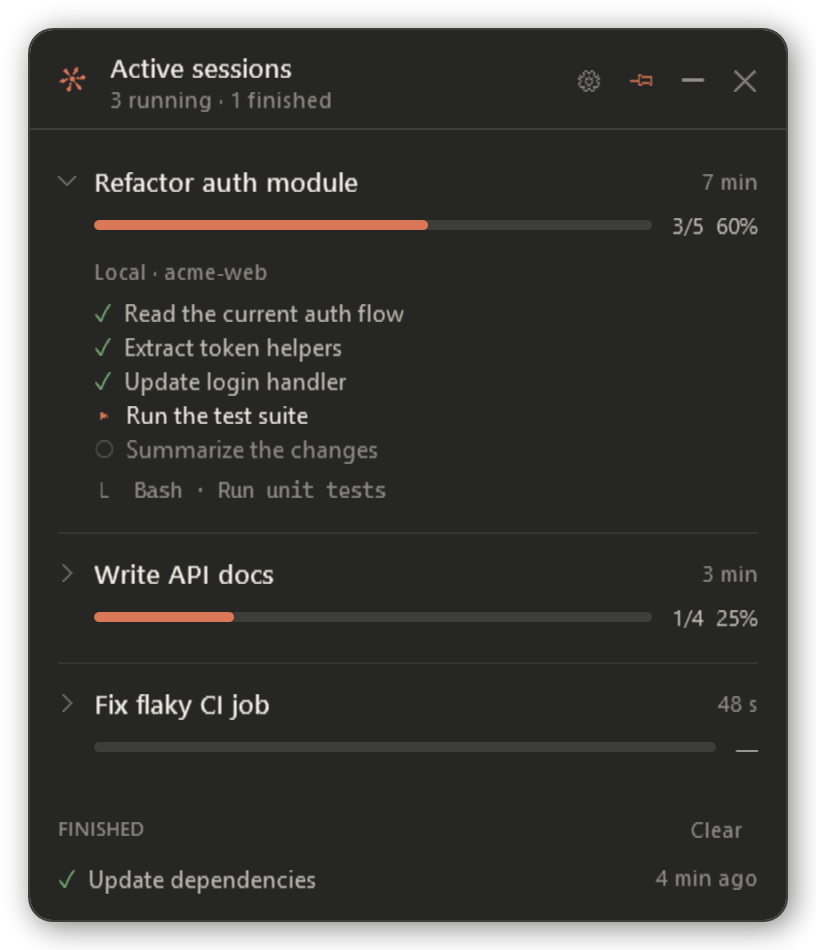
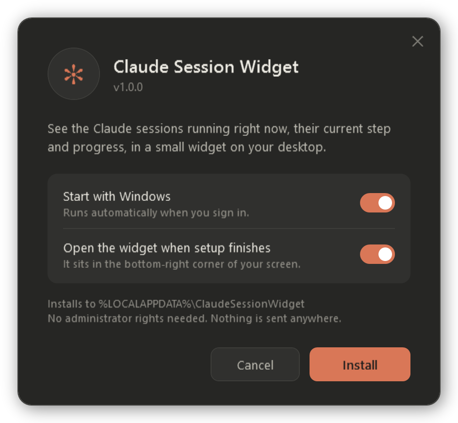
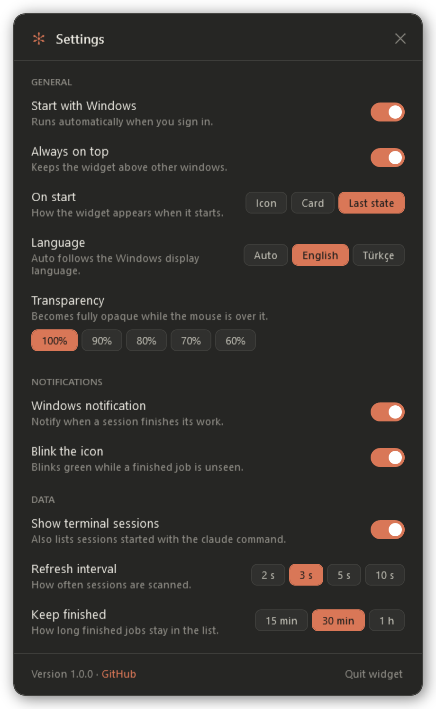
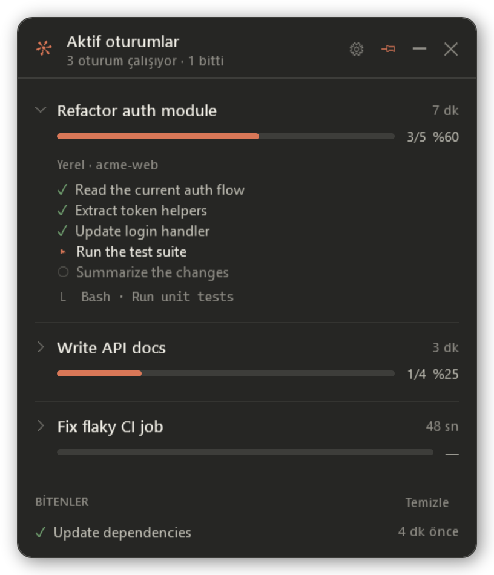

# ✻ Claude Session Widget

[](https://github.com/hasanuzn/claude-session-widget/actions/workflows/ci.yml)
[](https://github.com/hasanuzn/claude-session-widget/releases/latest)
[](LICENSE)

**English** · [Türkçe](#türkçe)

A small Windows desktop widget that shows the **Claude sessions running right now**, what each one
is **doing**, and how far along it is — without switching to the Claude app.

<p align="center">
  
  &nbsp;&nbsp;
  
</p>

If you run Claude in several sessions at once (local, WSL or terminal), you can see at a glance
which one is working on what, how many steps are done, and which one just finished.

> This is a community project. It is not made by, or affiliated with, Anthropic.

## Features

- **Icon ↔ card:** a round ✻ icon sits in the bottom-right corner; click it to open the session card.
- **Accordion rows:** each session shows its title and progress bar; click a title to expand its
  location, step list (✓ done, ▸ current, ○ pending) and latest tool call.
- **Finished alert:** when a session finishes, the icon blinks green and a Windows notification appears.
- **Live indicator:** the ✻ spins while anything is running; the badge shows how many sessions are running.
- **Tray icon:** hide the widget and it keeps running in the system tray.
- **Settings window** with English and Turkish UI (follows the Windows display language by default).
- Draggable, remembers its position, optional transparency. Nothing ever leaves your computer.

## Install

### Download (recommended)

1. Download `claude-session-widget-<version>.zip` from the
   [latest release](https://github.com/hasanuzn/claude-session-widget/releases/latest) and extract it.
2. Double-click **`Install.cmd`**. A small setup window opens: choose whether it starts with
   Windows and press **Install**.

<p align="center">
  
</p>

### One line

Open PowerShell and paste:

```powershell
irm https://raw.githubusercontent.com/hasanuzn/claude-session-widget/main/get.ps1 | iex
```

No administrator rights are needed. Running the same installer again updates the widget. The installer:

- copies the files to `%LOCALAPPDATA%\ClaudeSessionWidget`,
- adds **Claude Session Widget**, **… - Settings** and **… - Uninstall** to the Start menu,
- makes it start with Windows (you can turn this off in Settings),
- adds it to **Settings → Apps → Installed apps**,
- starts the widget.

For a console or scripted install use `install.ps1` instead of the window:
`powershell -ExecutionPolicy Bypass -File install.ps1 [-NoStartup] [-NoLaunch]`.

### "Windows protected your PC" / unknown publisher

The scripts are not code-signed, so Windows may warn the first time you run `Install.cmd` from a
downloaded zip. Choose **More info → Run anyway** (or right-click the zip → **Properties →
Unblock** before extracting). Everything the widget runs is plain PowerShell in this repository —
feel free to read it first. Some company security tools block unsigned PowerShell scripts entirely;
in that case ask your IT team.

## Settings



Open them with the ⚙ button on the card, **Settings…** in the tray icon's menu, or the
**Claude Session Widget - Settings** Start menu shortcut. Changes apply immediately.

| Setting | Default |
|---|---|
| Start with Windows | On |
| Always on top | On |
| On start: icon, card or last state | Last state |
| Language: auto, English, Türkçe | Auto |
| Transparency: 100–60 % (opaque on hover) | 100% |
| Windows notification when a session finishes | On |
| Blink the icon while a finished job is unseen | On |
| Show terminal (`claude` CLI) sessions | On |
| Refresh interval: 2 / 3 / 5 / 10 s | 3 s |
| Keep finished jobs listed: 15 / 30 / 60 min | 30 min |

Settings are stored in `%APPDATA%\ClaudeSessionWidget\settings.json`.

<br clear="right">

## How it works

The widget only **reads** local files. It changes nothing and never connects to the internet.

- **Which sessions are running:** each running `claude` process keeps a small status record
  (`busy` / `idle`) in `%USERPROFILE%\.claude\sessions\` (or `~/.claude/sessions` inside WSL);
  records of processes that have exited are ignored. The Claude desktop app's session list
  (`%LOCALAPPDATA%\Claude-Data\…\claude-code-sessions\*.json`) supplies titles and transcript
  locations, and is used as a fallback signal for SSH sessions.
- **Progress and current work:** the session transcript's task list (`update_plan` / `TodoWrite`)
  and latest tool call. WSL transcripts are read through `wsl.exe`.

Sessions that don't keep a task list show no progress bar, only their latest activity.

### Known limitations

- These are **undocumented internal files** of Claude Code and the desktop app. An update to
  Claude may change them and stop the widget from seeing sessions until it is updated.
- Sessions on a remote SSH host are detected but their progress can't be read.
- Windows only. Tested on Windows 11 with the Claude desktop app; please report other setups.

## Requirements

- Windows 10 or 11 (Windows PowerShell 5.1 and .NET Framework are built in)
- The Claude desktop app (Code tab) or the Claude Code CLI
- `wsl.exe` for WSL sessions

## Uninstall

Use **Claude Session Widget - Uninstall** in the Start menu, **Installed apps**, or `Uninstall.cmd`
from the zip. To keep your settings: `Uninstall.cmd -KeepSettings`.

## Troubleshooting

- If the widget doesn't open, check the log: `%TEMP%\claude-session-widget.log`
- To list the sessions it finds in the console:

  ```powershell
  powershell -NoProfile -ExecutionPolicy Bypass -File "$env:LOCALAPPDATA\ClaudeSessionWidget\claude-session-widget.ps1" -Test
  ```

## Contributing

Bug reports, translations and pull requests are welcome — see [CONTRIBUTING.md](CONTRIBUTING.md).
Run it from source with `powershell -NoProfile -ExecutionPolicy Bypass -STA -File src\claude-session-widget.ps1`,
try the UI without real sessions with `-Demo`, and run the tests with `tools\Invoke-Tests.ps1`.
Adding a language is one file: copy `src/lang/en.psd1`. Changes are listed in [CHANGELOG.md](CHANGELOG.md);
security issues go through [SECURITY.md](SECURITY.md).

## License

[MIT](LICENSE)

---

## Türkçe

Claude masaüstü uygulamasında **şu anda çalışan oturumları**, her birinin **ne yaptığını** ve
**ilerlemesini** masaüstünde küçük, ayrı bir pencerede gösteren Windows widget'ı.

<p align="center">
  
</p>

> Topluluk projesidir; Anthropic tarafından yapılmamıştır ve Anthropic ile bağlantılı değildir.

**Özellikler:** sağ altta ✻ simgesi, tıklayınca açılan kart; başlığına tıklayınca açılıp kapanan
oturum satırları (kapalıyken yalnızca başlık ve ilerleme çubuğu); biten işte yeşil yanıp sönme ve
Windows bildirimi; sistem tepsisi simgesi; ayarlar penceresi; İngilizce ve Türkçe arayüz (varsayılan
olarak Windows görüntü dilini izler).

**Kurulum:** [son sürümden](https://github.com/hasanuzn/claude-session-widget/releases/latest)
`claude-session-widget-<sürüm>.zip` dosyasını indirip açın ve **`Install.cmd`** dosyasına çift
tıklayın; açılan küçük kurulum penceresinde Windows açılışında başlayıp başlamayacağını seçip
**Kur**'a basın (aynı dosya kurulu sürümü günceller). Ya da PowerShell'e şunu yapıştırın:

```powershell
irm https://raw.githubusercontent.com/hasanuzn/claude-session-widget/main/get.ps1 | iex
```

Yönetici izni gerekmez; Başlat menüsüne kısayollar ekler, Windows açılınca başlatır (Ayarlar'dan
kapatılabilir) ve "Yüklü uygulamalar" listesine ekler. Betikler imzalı olmadığı için Windows ilk
çalıştırmada "Bilinmeyen yayımcı" uyarısı gösterebilir: **Ek bilgi → Yine de çalıştır** deyin.

**Ayarlar:** karttaki ⚙ düğmesi, tepsi menüsündeki **Ayarlar…** ya da Başlat menüsündeki
**Claude Session Widget - Ayarlar**. Windows açılınca başlatma, her zaman üstte, açılış görünümü,
dil (Otomatik / English / Türkçe), şeffaflık (%100–%60, fare üzerindeyken tam opak), Windows
bildirimi, yanıp sönme, terminal oturumları, yenileme aralığı ve bitenlerin listede kalma süresi
buradan değiştirilir.

**Bilinen sınırlamalar:** widget, Claude'un belgelenmemiş iç dosyalarını okur; Claude
güncellemeleri bunları değiştirirse widget'ın da güncellenmesi gerekebilir. Yalnızca Windows'ta
çalışır.

**Kaldırma:** Başlat menüsünden **Claude Session Widget - Kaldır**, "Yüklü uygulamalar" listesi ya da
`Uninstall.cmd`. Ayarları korumak için: `Uninstall.cmd -KeepSettings`.

**Sorun giderme:** hata kaydı `%TEMP%\claude-session-widget.log` dosyasındadır; bulunan oturumları
görmek için yukarıdaki `-Test` komutunu çalıştırın.

**Katkı:** hata bildirimi, çeviri ve PR'lar memnuniyetle karşılanır — ayrıntılar
[CONTRIBUTING.md](CONTRIBUTING.md) dosyasında.
